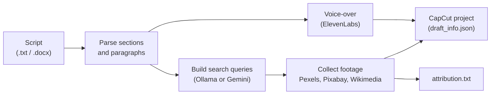

# Automated Documentary Video Pipeline

An automated pipeline for producing documentary-style videos. It parses a written script, collects matching stock footage from several free sources, generates a voice-over with text-to-speech, and exports everything as an editable CapCut project.

## How it works



1. **Parse:** the script is split into sections and paragraphs. The requested video length is divided over the sections by character count.
2. **Queries:** for every paragraph an AI model (a local Ollama model, or Gemini) proposes search queries based on the section's location and the concrete things the text mentions. The location is forced into every query.
3. **Collect:** for each query the configured sources are tried in order. Stock results are scored for relevance, duplicates are skipped, and credits are recorded.
4. **Voice-over:** one audio file is generated per paragraph.
5. **Export:** a CapCut draft is written: footage on the video track, voice-over on the audio track, and a faded title at the start of each section. Cuts get longer as the video progresses.

## Features

- Parses `.txt` (`# Title` headings) and `.docx` (bold paragraphs as titles) scripts.
- Fallback chain over Pexels video, Pixabay video, Wikimedia Commons, Pexels photos and Pixabay photos. The order is configurable.
- AI relevance scoring of stock results, plus a geographic filter that rejects content that names a different country.
- Duplicate protection by URL and file hash.
- Wikimedia images under non-commercial or no-derivatives licenses are skipped.
- Credits for every downloaded item are written to `attribution.txt`.
- Retries with backoff on network errors, HTTP 429 and 5xx responses.
- Photos are converted to short clips so they can be used on the timeline.
- Partial runs with `--from-section` / `--to-section`.
- `--dry-run` shows the plan without any network request or file written.
- If not enough footage is found, the video is built from what exists and the gaps are reported (see Limitations).

## Project structure

```
.
├── config/settings.example.yaml   # tunable settings (copy to settings.yaml)
├── examples/sample_script.txt     # short example script
├── src/video_pipeline/
│   ├── main.py                    # command-line entry point
│   ├── config.py                  # .env + YAML settings
│   ├── script_parser.py           # script -> sections and timings
│   ├── ai.py, landmarks.py        # query generation and relevance scoring
│   ├── geo_filter.py              # location forcing and rejection
│   ├── collector.py               # source fallback chain per paragraph
│   ├── footage/                   # pexels.py, pixabay.py, wikimedia.py
│   ├── voiceover.py               # ElevenLabs text-to-speech
│   ├── capcut_export.py           # CapCut draft writer
│   └── dedup.py, attribution.py, util.py
├── tests/                         # pytest tests (no network needed)
└── docs/images/                   # screenshots and demo
```

## Setup

You need Python 3.10 or newer and [FFmpeg](https://ffmpeg.org/) (both `ffmpeg` and `ffprobe` on your `PATH`). CapCut Desktop is only needed to open the exported project.

**macOS**

```bash
brew install ffmpeg
python3 -m venv venv
source venv/bin/activate
pip install -r requirements.txt
pip install -e .
cp .env.example .env
cp config/settings.example.yaml config/settings.yaml
```

**Windows (PowerShell)**

```powershell
winget install Gyan.FFmpeg
py -m venv venv
venv\Scripts\activate
pip install -r requirements.txt
pip install -e .
copy .env.example .env
copy config\settings.example.yaml config\settings.yaml
```

Then fill in `.env` with your own keys:

| Variable | Used for | Where to get it |
|---|---|---|
| `PEXELS_API_KEY` | Pexels video and photos | https://www.pexels.com/api/ |
| `PIXABAY_API_KEY` | Pixabay video and photos | https://pixabay.com/api/docs/ |
| `ELEVENLABS_API_KEY` | Voice-over | https://elevenlabs.io (Profile, API Keys) |
| `GEMINI_API_KEY` | Optional AI backend | https://aistudio.google.com |

Also set `voiceover.voice_id` in `config/settings.yaml` to the ID of a voice from your ElevenLabs library.

Wikimedia needs no key. If you do not want to use a keyed source, remove it from `footage.source_order` in the settings; otherwise the program stops and tells you which key is missing. For AI-generated queries, either run [Ollama](https://ollama.com/) locally or set `GEMINI_API_KEY`. Without any AI backend the pipeline still runs, with simpler queries.

## Usage

Show the plan without contacting any service:

```bash
python -m video_pipeline.main --script examples/sample_script.txt --dry-run
```

Run the full pipeline for a 3-minute video:

```bash
python -m video_pipeline.main --script examples/sample_script.txt --minutes 3
```

Other examples:

```bash
# voice-over only, or footage only
python -m video_pipeline.main --script my_script.docx --mode audio
python -m video_pipeline.main --script my_script.docx --mode video

# resume footage collection from section 4 to 6
python -m video_pipeline.main --script my_script.docx --mode video --from-section 4 --to-section 6

# also collect one Wikimedia image per sentence
python -m video_pipeline.main --script my_script.docx --wikimedia
```

Script format: in a `.txt` file every section starts with a `# Title` line. In a `.docx` file a paragraph that is entirely bold is a section title. The title of the first section is treated as the main country or region (when it has up to three words) and is added to the search queries, so make it the main place name.

Everything generated goes to `output/`: footage per section, `voiceovers/`, `attribution.txt`, a plan file and caches. The CapCut project is written to CapCut's projects folder; restart CapCut to see it.

Run the tests with `pip install -r requirements-dev.txt` and then `pytest`.

## Example output


## Limitations

- **Enough stock material must exist for your topic.** Free stock libraries are limited, and niche topics, specific events or people may return little or nothing relevant. When too little footage is found, the pipeline builds the video from what it found, reuses clips and reports which paragraphs fell short (in the log and in `missing_visuals_report.txt` inside the CapCut project). The result can then contain repeated or loosely related footage. Choose topics and wording accordingly, add sources, or request a shorter video.
- AI relevance scoring is a heuristic. Stock clips are judged by their short label or tags only, so unrelated clips can still slip through; review the result.
- The CapCut draft format is reverse-engineered and may stop working with newer CapCut versions. It was developed on macOS. Windows paths are supported but untested, and newer CapCut versions on Windows may store drafts in a form this tool cannot write; set `capcut.projects_dir` if your projects live elsewhere.
- Voice-over and CapCut export need real accounts and keys, so they are not covered by the automated tests.

## Media sources & licensing

- **Pexels** and **Pixabay** content is provided under their own licenses ([Pexels](https://www.pexels.com/license/), [Pixabay](https://pixabay.com/service/license/)).
- **Wikimedia Commons** images carry individual licenses, mostly Creative Commons, which usually require attribution and in some cases share-alike. Non-commercial and no-derivatives images are skipped automatically.
- The tool records source, creator, URL and license of everything it downloads in `output/attribution.txt`. Use it when you publish.
- You are responsible for following the license terms of every source, the terms of ElevenLabs for generated audio, and the rules of any platform you publish on. Check the licenses before publishing. Generated media and `output/` are not part of this repository.

## What I learned

- Combining several APIs with different response formats behind one fallback chain, and keeping the credits and duplicate checks consistent across all of them.
- Handling rate limits and flaky networks with retries and backoff, and failing early with clear messages when configuration is missing.
- Using an LLM for query generation and relevance scoring, and where its judgments need guard rails such as a geographic filter and quick rule-based checks.
- Keeping audio and video aligned on a timeline: measuring real media durations, distributing time across sections and paragraphs, and writing a project format that an editor can open.

## Possible improvements

- Score relevance with image or video embeddings instead of text labels.
- Add transitions to the CapCut export, and an export option for other editors.
- Add integration tests with recorded API responses.

## Tech stack

Python, requests, python-docx, PyYAML, python-dotenv, pytest, FFmpeg, Pexels / Pixabay / Wikimedia APIs, ElevenLabs API, Ollama and Gemini.
